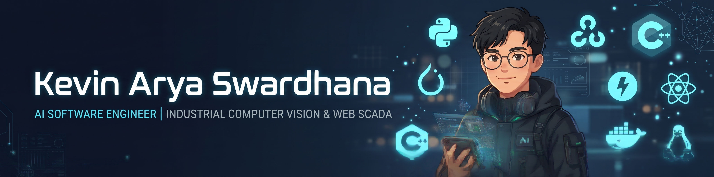

<!-- ==================== FUTURISTIC HEADER BANNER ==================== -->
<div align="center">
  
</div>

<br />

<!-- ==================== CYBER TYPING TELEMETRY ==================== -->
<div align="center">
  <a href="https://github.com/definedbykevin">
    
  </a>
</div>

<!-- ==================== HUD SOCIAL & CREDENTIAL BADGES ==================== -->
<p align="center">
  <a href="https://www.linkedin.com/in/kevinaryaswardhana" target="_blank">
    
  </a>
  <a href="https://instagram.com/kevinarya_swardhana" target="_blank">
    
  </a>
  <a href="mailto:kevinaryastarigan@gmail.com">
    
  </a>
  <a href="https://drive.google.com/drive/folders/1Kt7QdHMi2MB1WkChQJonqsdbHNb2cFeh" target="_blank">
    
  </a>
</p>

<!-- ==================== TELEMETRY STATUS BAR ==================== -->
<p align="center">
  
  
  
</p>


### ⚡ `SYSTEM.IDENTITY // < {definedbykevin} />`

```yaml
engineer_profile:
  name: "Kevin Arya Swardhana"
  alias: "< {definedbykevin} />"
  role: "Lead AI/ML Engineer (Division AI & Digitalization)"
  organization: "PT Premier Engineering Indonesia"
  education: "B.Sc. in Informatics Engineering (Cum Laude) — Universitas Mikroskil"
  core_domains:
    - "Industrial Computer Vision & Multi-Stream Edge AI Inference"
    - "Intelligent Web-Based SCADA & Real-Time Telemetry Systems"
    - "Industrial Protocol Integration (PLC, SCADA, MQTT, OPC UA, Modbus, REST API)"
  global_presence:
    - "Technical Product Representative @ PIPOC Kuala Lumpur, TPOMI & PALMEX"
    - "Active Tech Speaker in AI & Industrial Digitalization"
